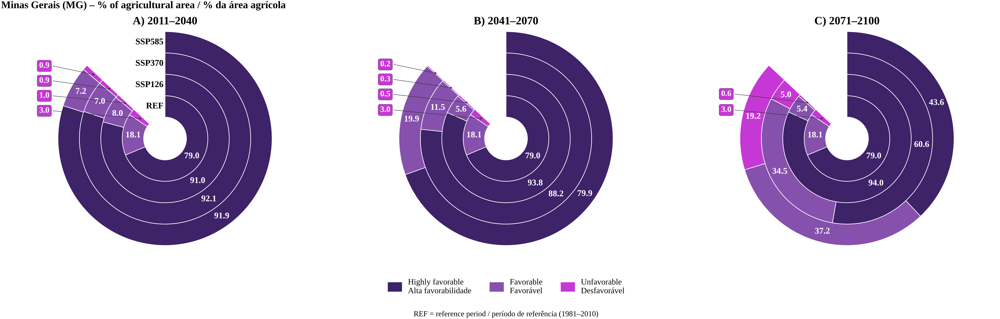
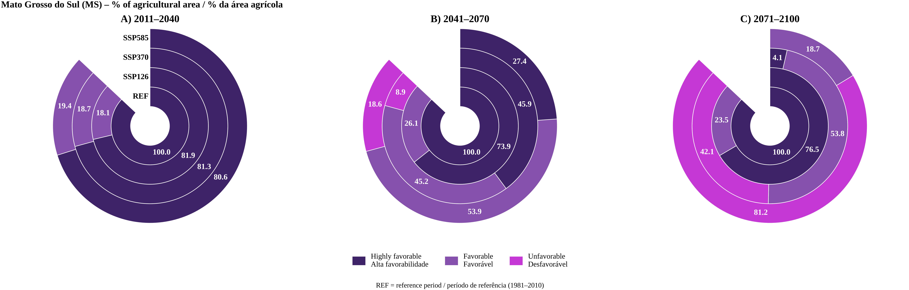
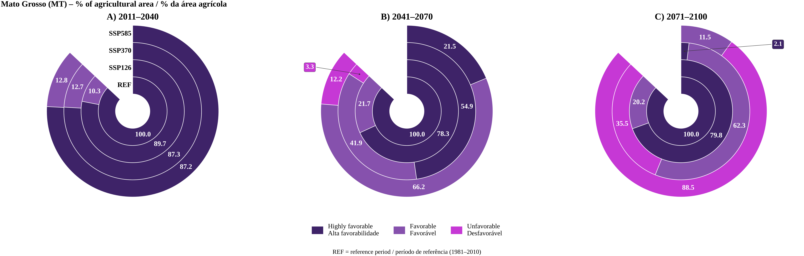
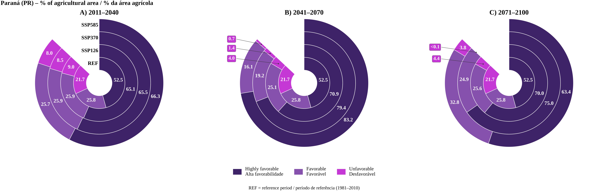
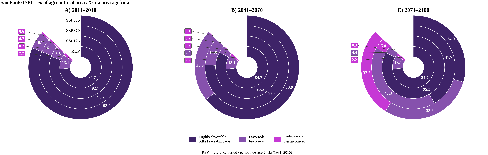

# Brazil — Agricultural-area donut charts

Bilingual (English/Portuguese) donut charts summarizing the climate favorability zoning of the peanut Cercospora leaf spot complex in the five Brazilian states covered by **CercoZon**.

Each figure shows the percentage of the state's **agricultural area** (MapBiomas mask) in each favorability class, for three future climate normals:

- **A)** 2011–2040
- **B)** 2041–2070
- **C)** 2071–2100

In each panel, the rings from the center outward are **REF** (reference period, 1981–2010), **SSP1-2.6**, **SSP3-7.0** and **SSP5-8.5**.

| Color | Class (EN) | Classe (PT) |
|---|---|---|
| Dark purple | Highly favorable | Alta favorabilidade |
| Purple | Favorable | Favorável |
| Magenta | Unfavorable | Desfavorável |

Zoning criteria: mean air temperature over the September–April window + water threshold P* = 46.1 mm/month. The values plotted are the same as in the `Report_Zoning_<UF>_All_Normals.txt` files in [`../Scenarios_Climate/`](../Scenarios_Climate/).

## Files

| File | State |
|---|---|
| `Rosca_agricola_BR_MG_bilingue.png` | Minas Gerais (MG) |
| `Rosca_agricola_BR_MS_bilingue.png` | Mato Grosso do Sul (MS) |
| `Rosca_agricola_BR_MT_bilingue.png` | Mato Grosso (MT) |
| `Rosca_agricola_BR_PR_bilingue.png` | Paraná (PR) |
| `Rosca_agricola_BR_SP_bilingue.png` | São Paulo (SP) |

## Preview

### Minas Gerais (MG)

### Mato Grosso do Sul (MS)

### Mato Grosso (MT)

### Paraná (PR)

### São Paulo (SP)

