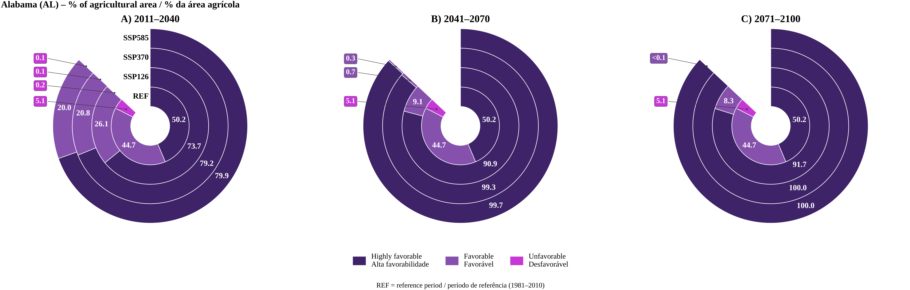
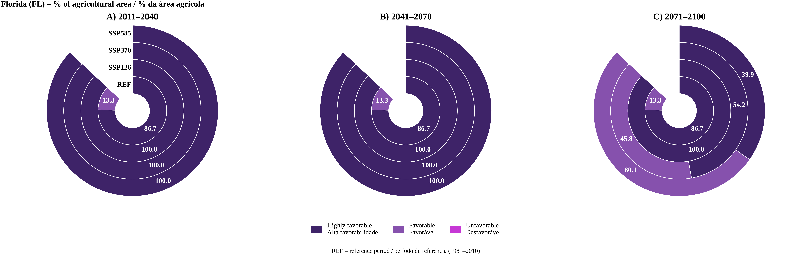
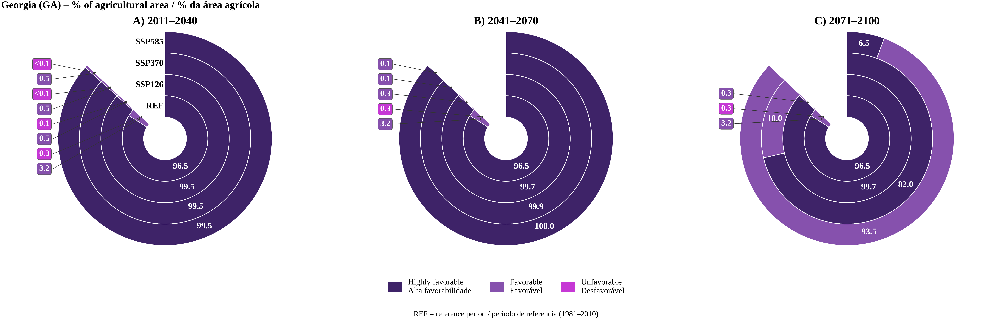
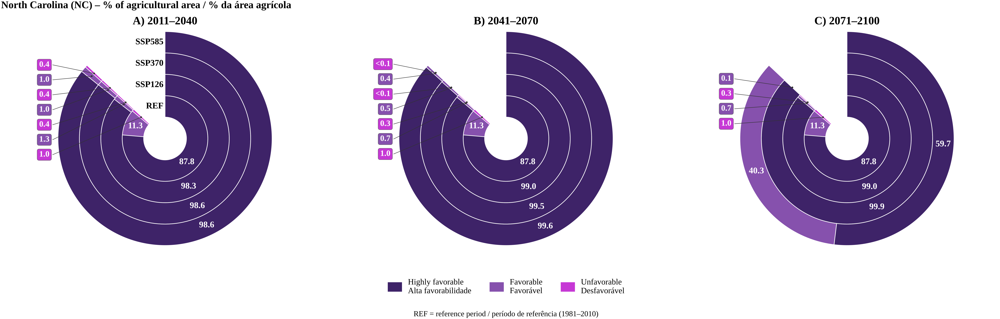
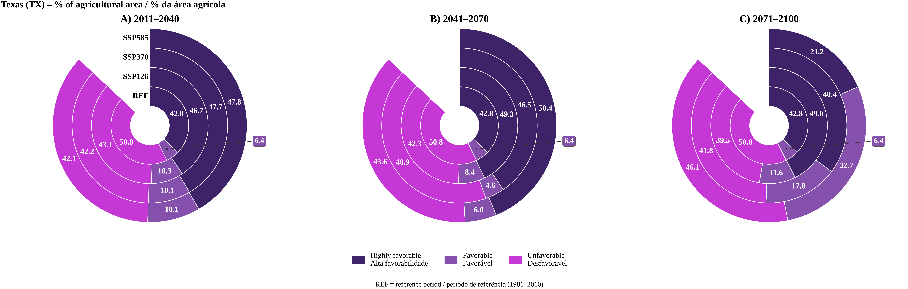

# United States — Agricultural-area donut charts

Bilingual (English/Portuguese) donut charts summarizing the climate favorability zoning of the peanut Cercospora leaf spot complex in the five U.S. states covered by **CercoZon**.

Each figure shows the percentage of the state's **agricultural area** (USDA Cropland Data Layer 2025 mask) in each favorability class, for three future climate normals:

- **A)** 2011–2040
- **B)** 2041–2070
- **C)** 2071–2100

In each panel, the rings from the center outward are **REF** (reference period, 1981–2010), **SSP1-2.6**, **SSP3-7.0** and **SSP5-8.5**.

| Color | Class (EN) | Classe (PT) |
|---|---|---|
| Dark purple | Highly favorable | Alta favorabilidade |
| Purple | Favorable | Favorável |
| Magenta | Unfavorable | Desfavorável |

Zoning criteria: mean air temperature over the state's planting-harvest window + water threshold P* = 58.1 mm/month. The values plotted are the same as in the `Report_Zoning_<ST>_All_Normals.txt` files in [`../Scenarios_Climate/`](../Scenarios_Climate/).

## Files

| File | State | Window |
|---|---|---|
| `Rosca_agricola_EUA_AL_bilingue.png` | Alabama (AL) | March–October |
| `Rosca_agricola_EUA_FL_bilingue.png` | Florida (FL) | March–November |
| `Rosca_agricola_EUA_GA_bilingue.png` | Georgia (GA) | April–October |
| `Rosca_agricola_EUA_NC_bilingue.png` | North Carolina (NC) | May–October (Virginia type) |
| `Rosca_agricola_EUA_TX_bilingue.png` | Texas (TX) | April–November (sub-regions) |

## Preview

### Alabama (AL)

### Florida (FL)

### Georgia (GA)

### North Carolina (NC)

### Texas (TX)

